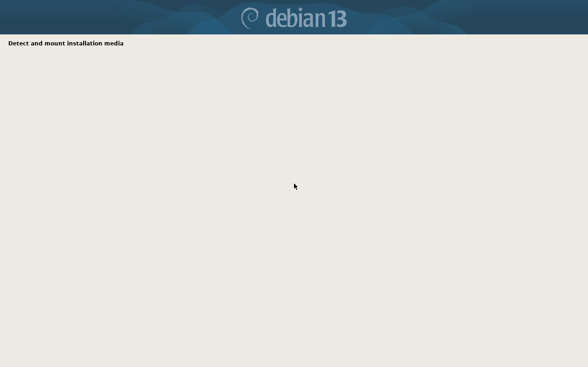
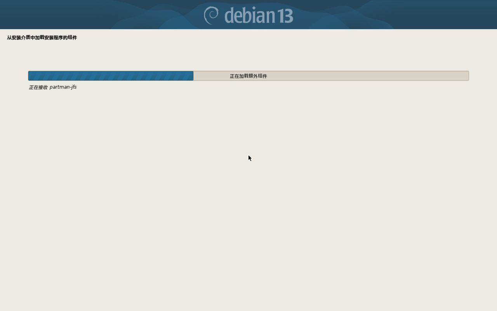

# open绪山真寻Linux · open mahiro Linux

基于 **Debian 13.7.0 (trixie)** 的定制发行版，面向 Intel / AMD 64 位平台。
XFCE 桌面、完整中文环境、Wine 兼容层开箱即用。

> **此软件由华夏服饰历史博物馆年卡会员 绪山真寻 开发。**

---

## 快速开始

| 项目 | 内容 |
| --- | --- |
| 镜像 | `open-mahiro-linux-13.7.0-amd64.iso`（945 MB） |
| 启动 | BIOS + UEFI 双启动，isohybrid，可写 U 盘 |
| 类型 | 安装型（非 Live），装进虚拟机或整块硬盘 |
| **用户名** | **`mahiro`** |
| **密码** | **`mahiro`** |

安装方式、Wine 用法、deb 管理详见：

- 📄 [使用说明（Markdown，推荐阅读）](docs/使用说明.md)
- 📄 [使用说明（纯文本 TXT）](docs/使用说明.txt)

---

## 特性

- **桌面**：XFCE，轻量稳定，开关机快
- **中文**：`zh_CN.UTF-8`、Asia/Shanghai、Noto CJK / 文泉驿字体、fcitx5 拼音（Ctrl+空格）
- **软件**：LibreOffice（中文语言包+帮助）、Firefox ESR 中文版、VLC、GIMP、GParted、Evince
- **deb 管理**：`apt` / `dpkg` / Synaptic / GDebi 全套
- **Windows 兼容层**：Wine 64 + Wine 32 (i386) + winetricks；双击 `.exe` 即可运行；菜单内置「安装 Windows 软件」向导
- **品牌化**：启动菜单、GRUB 主题、登录界面、桌面壁纸统一为绪山真寻素材

---

## 安装实测

在 QEMU（TCG）中验证 BIOS 引导与自动安装入口：

第二张图可见安装器已按 preseed 切换到中文，说明应答文件被正确读取。

---

## 构建

构建脚本位于 [`build/`](build/)：

| 文件 | 作用 |
| --- | --- |
| `preseed.cfg` | Debian 安装器自动应答（语言、分区、账户、软件包、后期脚本） |
| `setup.sh` | 安装完成后的品牌化、中文输入法、Wine 配置（在目标系统 chroot 内执行） |
| `build.sh` | 以 Debian netinst ISO 为基础，替换菜单/启动图/应答文件并重新打包 |

大致流程：解开官方 netinst ISO → 写入 `open-mahiro/` 目录 → 替换 `isolinux.cfg` 与 `grub.cfg`
→ 重算 `md5sum.txt` → `xorriso` 重新生成混合启动 ISO。

---

## 已知限制

1. 安装过程**必须联网**（netinst 型安装盘，需下载 1.5–2 GB 软件包）；
2. 自动安装会**清空目标盘**；
3. 需关闭 Secure Boot；
4. 仅支持 x86_64，不支持 ARM / 树莓派；
5. Wine 兼容性有限，带反作弊的网游与部分国产软件无法运行。

---

## 许可

本发行版基于 Debian GNU/Linux，遵循 Debian 的各项自由软件许可。
构建脚本与文档可自由使用、修改、再分发。
系统内壁纸素材版权归原作者所有，仅作个人使用。
